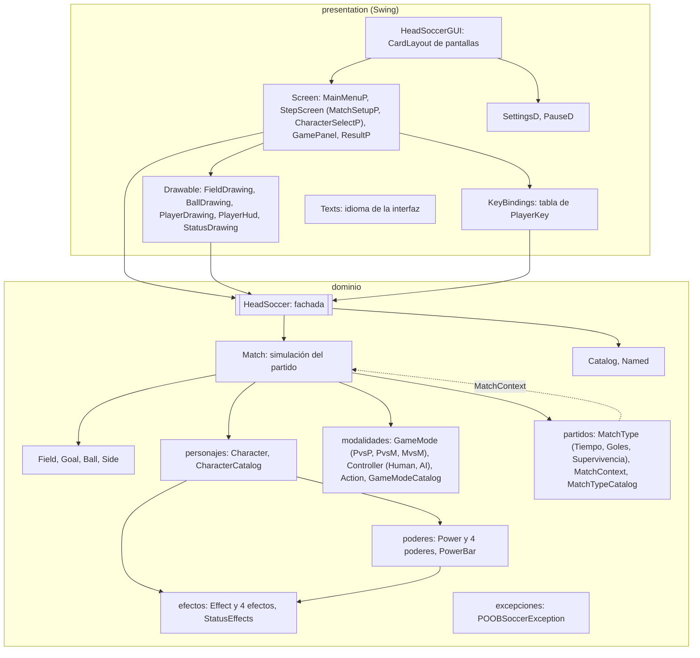

<div align="center">

# ⚽ POOBSoccer (2026-2)
### Programación Orientada a Objetos
**Escuela Colombiana de Ingeniería Julio Garavito**

---

[](https://www.java.com/)
[](#)
[](#)
[](#)

</div>

---

## 📑 Tabla de Contenidos
- [Inspiración: Head Soccer](#-inspiración-head-soccer)
- [Propuesta: POOBSoccer](#-propuesta-poobsoccer)
- [Mecánicas del Juego](#-mecánicas-del-juego)
- [Controles](#-controles)
- [Modalidades de Juego](#-modalidades-de-juego)
- [Tipos de Partido](#-tipos-de-partido)
- [Jugadores y Estadísticas](#-jugadores-y-estadísticas)
- [Sistema de Poderes](#-sistema-de-poderes)
- [Reglas y Puntajes](#-reglas-y-puntajes)
- [Cómo ejecutar](#-cómo-ejecutar)
- [Arquitectura y patrones](#-arquitectura-y-patrones)
- [Autores y Colaboradores](#-autores-y-colaboradores)
- [Referencias](#-referencias)

---

## 🎮 Inspiración: Head Soccer

**Head Soccer** es un videojuego de fútbol arcade en 2D para celulares desarrollado por la empresa surcoreana **D&D Dream** y lanzado en 2012. Se ha vuelto muy popular por sus partidos rápidos de uno contra uno y por unos controles tan sencillos que cualquiera aprende a jugar en segundos.

* **Dinámica básica:** Cada jugador controla un personaje que representa a un país. Los personajes se mueven a los lados, saltan y patean para meter el balón en el arco rival.
* **Tiros especiales:** Al llenar una barra de poder, el personaje lanza un tiro especial (fuego, hielo, rayo, etc.) que puede terminar en gol o dejar al rival inmovilizado por unos segundos.
* **Atributos:** Cada personaje posee sus propias estadísticas de velocidad, salto y fuerza, además de un tiro especial único.
* **Modos en la versión móvil original:** Arcade, Torneo, Supervivencia, Liga, Head Cup y Death Mode.

---

## 🚀 Propuesta: POOBSoccer

En este proyecto final llevaremos la esencia de **Head Soccer** desde los dispositivos móviles al computador. Nuestra versión, **POOBSoccer**, conserva el dinamismo de los partidos rápidos con poderes especiales, permitiendo que dos jugadores compitan en el mismo teclado e incorporando las siguientes novedades:

- [x] **Tres modalidades:** Jugador vs Jugador, Jugador vs Máquina y Máquina vs Máquina.
- [x] **Tres tipos de partido:** Por tiempo, por goles y supervivencia.
- [x] **Personajes diferenciados:** Atributos propios y poderes especiales temáticos según el país.
- [x] **Impacto estratégico:** Poderes con efectos de estado que alteran las condiciones del oponente y cambian el rumbo del partido.

---

## 🏟️ Mecánicas del Juego

* **Perspectiva y Entorno:** Partido de fútbol 2D de uno contra uno con vista lateral. Cada jugador defiende su portería y busca anotar en el arco contrario.
* **Física:** El balón está afectado por la gravedad y cuenta con física de rebote en el suelo, los travesaños/arcos y los límites de la cancha.
* **Información Abierta:** Ambos jugadores tienen visibilidad total y en tiempo real de toda la cancha, el balón, los personajes, el marcador, el cronómetro y las barras de poder.
* **Reanudación tras Gol:** Después de cada anotación, tanto los jugadores como el balón regresan a su posición inicial, cayendo el balón nuevamente desde el centro del campo.

---

## 🕹️ Controles

Ambos jugadores interactúan de forma local compartiendo el mismo teclado:

| Acción | Jugador 1 | Jugador 2 |
| :--- | :---: | :---: |
| **Mover a la izquierda** | <kbd>A</kbd> | <kbd>←</kbd> |
| **Mover a la derecha** | <kbd>D</kbd> | <kbd>→</kbd> |
| **Saltar** | <kbd>W</kbd> | <kbd>↑</kbd> |
| **Patear** | <kbd>S</kbd> | <kbd>↓</kbd> |
| **Usar poder especial** | <kbd>Q</kbd> | <kbd>Ctrl Derecho</kbd> |
| **Pausar el partido** | <kbd>P</kbd> o <kbd>Esc</kbd> | <kbd>P</kbd> o <kbd>Esc</kbd> |

Las teclas se mantienen presionadas: moverse, saltar, patear y armar el poder duran mientras la tecla siga abajo. En **Máquina vs Máquina**, y para el jugador 2 en **Jugador vs Máquina**, el teclado no controla a la máquina.

---

## 👥 Modalidades de Juego

POOBSoccer implementa tres configuraciones de control y enfrentamiento:

1. **Jugador vs Jugador (PvsP):** Dos jugadores humanos enfrentándose en el mismo teclado.
2. **Jugador vs Máquina (PvsM):** Un jugador humano compitiendo contra un oponente controlado por la inteligencia del juego.
3. **Máquina vs Máquina (MvsM):** Ambos personajes son operados de forma automatizada por la máquina.

---

## ⏱️ Tipos de Partido

* **Por Tiempo:**
  * Duración estándar de 60 segundos.
  * Gana quien posea mayor número de anotaciones al expirar el tiempo.
  * En caso de empate, se define por **Gol de Oro** (muerte súbita: el primero en anotar gana).
* **Por Goles:**
  * Sin límite de tiempo.
  * Resulta ganador el primero en alcanzar la meta pactada: **3, 5 o 7 goles**.
* **Supervivencia:**
  * Modo exclusivo para la modalidad **PvsM**.
  * El jugador disputa una serie continua de partidos contra la máquina sin tiempo límite.
  * Se compite mediante un sistema de vidas o balones: cada vez que se recibe una anotación, se pierde un balón. El partido finaliza para quien agote primero sus balones.

---

## 👤 Jugadores y Estadísticas

### Interfaz del Jugador
En pantalla se visualizan en todo momento los siguientes datos de cada competidor:
* **Identificación:** Nombre y país representativo (equipo).
* **Goles:** Conteo de anotaciones registradas en el encuentro actual.
* **Barra de poder:** Indicador gráfico con el porcentaje de carga.
* **Poder activo:** Indicador del poder disponible en ese instante.

### Atributos
Cada personaje posee estadísticas graduadas en una escala numérica de **1 a 5**:
* 🏃 **Velocidad**
* 🦘 **Salto**
* 💥 **Fuerza**
* ⭐ **Poder Único**

---

## ⚡ Sistema de Poderes

El poder especial de cada personaje está directamente vinculado a su país de origen. 

* **Carga:** La barra de energía se recarga progresivamente con el tiempo. Solo puede liberarse cuando alcanza el $100\%$ de su capacidad.
* **Activación:** Se activa al impactar el balón y desencadena efectos directos sobre el rival.

### Personajes disponibles
La estadística **Poder Único** fija la rapidez de la barra: se recarga $2 \times$ Poder Único por ciento por segundo. Con la barra llena, la tecla de poder **arma** el poder (con la barra incompleta no pasa nada) y la siguiente patada que conecta con el balón lo **dispara**: el rival recibe el efecto y la barra vuelve a cero. Si el rival ya tiene ese efecto, el nuevo lo reemplaza y reinicia su duración.

| Personaje | País | Velocidad · Salto · Fuerza | Poder Único (recarga) | Poder | Efecto en el rival | Duración |
| :--- | :--- | :---: | :---: | :--- | :--- | :---: |
| Jacob | Canadá | 3 · 3 · 4 | 3 (6 %/s) | Congelamiento | No puede moverse, saltar ni patear | 3 s |
| Kenji | Japón | 5 · 4 · 2 | 2 (4 %/s) | Aturdimiento | No puede moverse, saltar ni patear | 3 s |
| Mateo | Colombia | 4 · 3 · 3 | 4 (8 %/s) | Confusión | Izquierda y derecha invertidas | 5 s |
| Rafael | Brasil | 4 · 5 · 3 | 3 (6 %/s) | Reducción | Cuerpo y hitbox a la mitad | 6 s |

### Ejemplos de Habilidades:
* ❄️ **Congelación (Canadá):** Encierra al oponente en un bloque de hielo sólido durante unos segundos, anulando su movimiento.
* 🔍 **Reducción:** Encoge temporalmente al oponente a un tamaño diminuto, reduciendo su alcance de cobertura.
* 🌀 **Confusión:** Invierte por unos momentos los controles de desplazamiento del oponente.

---

## ⚖️ Reglas y Puntajes

### Sistema de Puntuación
* **Gol a favor:** Balón en el arco rival suma **$+1$ punto**.
* **Autogol:** Si el balón ingresa en la portería propia, se concede **$+1$ punto al rival**.

### Normas del Encuentro
1. **Inicio:** El juego arranca con marcador inicial de $\$0-0\$$, barras de poder vacías y cada participante ubicado en su mitad respectiva de campo.
2. **Convalidación de gol:** El balón debe traspasar en su totalidad la línea de meta.
3. **Uso de poder:** Requiere obligatoriamente que la barra se encuentre al tope de carga.
4. **Estado de Aturdimiento:** Un personaje alcanzado por ataques o patadas del rival entra en estado de aturdimiento durante **3 segundos**, periodo en el cual queda inhabilitado para moverse, saltar o patear.
5. **Pausa:** La partida puede suspenderse de manera provisional en cualquier instante.
6. **Desempate:** En partidas por tiempo terminadas en empate, se aplica el criterio de muerte súbita (**Gol de Oro**).

---

## 🛠️ Cómo ejecutar

Requisitos: JDK 8 o superior (`javac` y `java` en el `PATH`). Todas las órdenes se ejecutan desde la raíz del repositorio; el código es UTF-8.

**Compilar y jugar** (Git Bash, Linux o macOS):

```bash
javac -encoding UTF-8 -d out $(find src -name "*.java")
java -cp out presentation.HeadSoccerGUI
```

**Pruebas unitarias** (JUnit 5 con el lanzador de consola incluido en `lib/`):

```bash
javac -encoding UTF-8 -d out -cp lib/junit-platform-console-standalone.jar $(find src test -name "*.java")
java -jar lib/junit-platform-console-standalone.jar execute -cp out --scan-classpath
```

En PowerShell (Windows), la lista de fuentes se obtiene así:

```powershell
javac -encoding UTF-8 -d out -cp lib\junit-platform-console-standalone.jar (Get-ChildItem -Recurse src, test -Filter *.java).FullName
java -jar lib\junit-platform-console-standalone.jar execute -cp out --scan-classpath
java -cp out presentation.HeadSoccerGUI
```

**Recorrido del juego:** Menú → *Jugar* → modalidad y tipo de partido → personaje de cada jugador → partido → resultado → *Siguiente* (vuelve a la selección de personajes para una revancha). *Configuración* cambia el idioma de la interfaz (Español / English).

---

## 🏛️ Arquitectura y patrones

### Capas y paquetes

La presentación (Swing) solo conoce la fachada `HeadSoccer` y `POOBSoccerException`, y le habla con tipos simples (índices, `String`, `int`, `double`, `boolean` y arreglos). El dominio no depende de AWT ni de Swing, por eso todo se prueba con JUnit sin interfaz.



**Un cuadro del juego:** un `javax.swing.Timer` de 16 ms llama a `GamePanel.advance()`, que mide el tiempo real (con tope de 0,1 s para que una pausa de la ventana no haga saltar la física) y llama a `HeadSoccer.updateTick(dt)`. `Match` pide a cada `Controller` las intenciones de su personaje, actualiza los personajes con `dt`, avanza el balón en pasos fijos de 1/60 s, revisa los goles con `Field.scorerOf` y deja que el `MatchType` avance su reloj. Luego el panel redibuja su lista de `Drawable` y, si el partido terminó, muestra `ResultP`.

### Patrones aplicados

| Patrón | Dónde y para qué |
| :--- | :--- |
| **Singleton** | Solo dos: `HeadSoccer.getInstance()` (una sesión de juego para toda la aplicación; `newGame()` la reinicia) y `Texts.getInstance()` (la tabla de textos y el idioma elegido). Los catálogos **no** son Singleton: los crea la fachada. |
| **Facade / Controller (GRASP)** | `HeadSoccer` recibe todos los eventos del sistema (selecciones, inicio, tick, pausa, teclas) y valida antes de delegar en `Match` o en los catálogos. La vista solo traduce eventos de Swing: el `Timer` llama a `updateTick` y `KeyBindings` a `pressAction`/`releaseAction`. |
| **Template Method** | `Controller.control` (pasos `direction`, `wantsJump`, `wantsKick`, `wantsPower`); `MatchType.goalScored`, final, que ignora los goles de un partido terminado y delega en `onGoal`; `SurvivalMatch.Lives.lose` con el paso `exhausted()` (jugador o rival); `Power.applyEffect` con el paso `createEffect()`; `Screen.enter()` = `onShow()` + foco del teclado; `StepScreen.onShow()` rotula título y botones y delega en `refresh()`. |
| **Factory Method** | `Power.createEffect()` (cada poder crea su efecto) y `GameMode.createPlayer1Controller()` / `createPlayer2Controller()` (cada modalidad crea los controladores). |
| **Polymorphism / Strategy** | En vez de condicionales por tipo: `GameMode` (quién controla y si admite Supervivencia), `MatchType` (`supports`, `onGoal`, `getStatusText`), los efectos redefinen `allowsActions`, `getScale` y `getHorizontalSign`, `Controller` humano o máquina, `Lives` del jugador o del rival, la lista de `Drawable`, `Screen.onShow`, el enum `Side` y la tabla de `KeyBindings` en vez de un `switch` de teclas. |
| **Prototype** | `Character.copy()` (con `PowerBar.fresh()`): cada partido recibe copias de los personajes elegidos, así dos jugadores con el mismo personaje no comparten estado y una revancha empieza limpia. `CharacterCatalog.nextAfter` entrega una copia del siguiente rival. |
| **Command** | `PlayerKey`: una tecla es el par (jugador, acción) que sabe presionarse y soltarse sobre la fachada. |
| **Information Expert** | `Ball` resuelve sus rebotes, empujes y patadas; `Goal` decide si el balón está adentro y el rebote en el travesaño; `Field` sabe quién anota y desde dónde cae el balón; `Character` patea, empuja y salta; `PowerBar` carga, arma y dispara; `StatusEffects` combina los efectos; cada `MatchType` arma su texto de estado; `CharacterCatalog` conoce el orden de los rivales y los datos de cada personaje; `Match.index` valida la numeración de jugadores. |
| **Creator** | `HeadSoccer` crea los catálogos y cada `Match`; `Match` crea la cancha, el balón y (por la modalidad) los controladores; `Character` crea su `PowerBar` y sus `StatusEffects`; cada catálogo crea sus opciones; `SurvivalMatch` crea sus `Lives`; `HeadSoccerGUI` crea las pantallas y `GamePanel` sus `Drawable` y su `KeyBindings`. |
| **Protected Variations** | Abstracciones `Power`, `Effect`, `Controller`, `GameMode`, `MatchType` e interfaces `MatchContext`, `Named`, `Drawable`. Las modalidades, los controladores y los tipos de partido concretos solo son visibles dentro de su paquete: fuera de él únicamente se conoce su catálogo y su clase abstracta. `MatchType` lee el partido solo por `MatchContext`, la vista solo ve tipos simples y `Texts` aísla el idioma. |
| **High Cohesion / Low Coupling** | La fachada solo valida y delega; la simulación vive en `Match`; `Character` reparte la barra y los efectos en `PowerBar` y `StatusEffects`; `Goal` no conoce personajes; la vista depende únicamente de `HeadSoccer`. |
| **Law of Demeter** | Sin cadenas `a.getB().c()`: la fachada pregunta a `CharacterCatalog` los datos de un personaje y a `Match` los de un jugador, y `Character.getPowerName()` responde por su poder. |

### Decisiones de diseño

* **Teclas mantenidas en `Controller`.** `press`, `release` y `releaseAll` son el contrato de entrada de todo controlador: la fachada entrega las teclas a cualquier jugador y `AIController` las ignora a propósito, por eso el teclado no mueve a la máquina sin preguntar nunca si un jugador es humano. `HumanController` recibe el personaje y el balón sin usarlos porque es la firma común del método plantilla.
* **Armar el poder con la barra incompleta no lanza excepción.** La tecla es una intención continua (se consulta en cada tick); la regla del 100 % la hace cumplir `PowerBar.arm()`.
* **Lados de la cancha.** `Side` guarda las posiciones iniciales del enunciado (200 y 700) y el sentido de ataque; los arcos de `Field` guardan qué jugador anota en cada uno, y así el autogol se acredita sin código especial.
* **Pausa.** `pause()` suelta las teclas mantenidas. Mientras `PauseD` (modal) está abierta el `Timer` sigue corriendo, pero `updateTick` no avanza un partido en pausa.
* **Idioma.** Es una preferencia de la vista, guardada en `Texts`; los nombres del dominio (modalidades, personajes, poderes, efectos y mensajes de error) se muestran tal cual.

---

## 👥 Autores y Colaboradores

* **Propuesta:**
  * Mateo Sánchez García
  * María Angélica Pérez Mesa
* **Colaboradores:**
  * Wilmar Edison Beltrán
  * Santiago Hernández Sarmiento

---

## 📚 Referencias

* D&D Dream. (s. f.). *Head Soccer*. https://dnddream.com/dnddream_web/app_game_06.htm
* TouchArcade. (s. f.). *Head Soccer*. https://toucharcade.com/games/head-soccer
* TV Tropes. (s. f.). *Head Sports (serie de videojuegos)*. https://tvtropes.org/pmwiki/pmwiki.php/VideoGame/HeadBoxing
